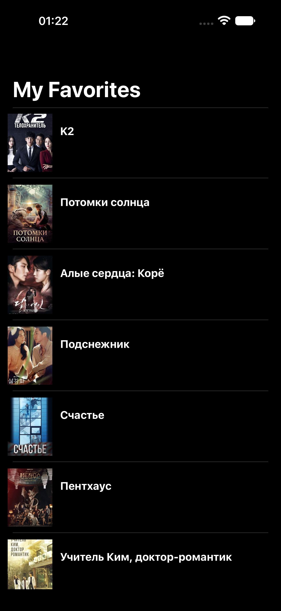
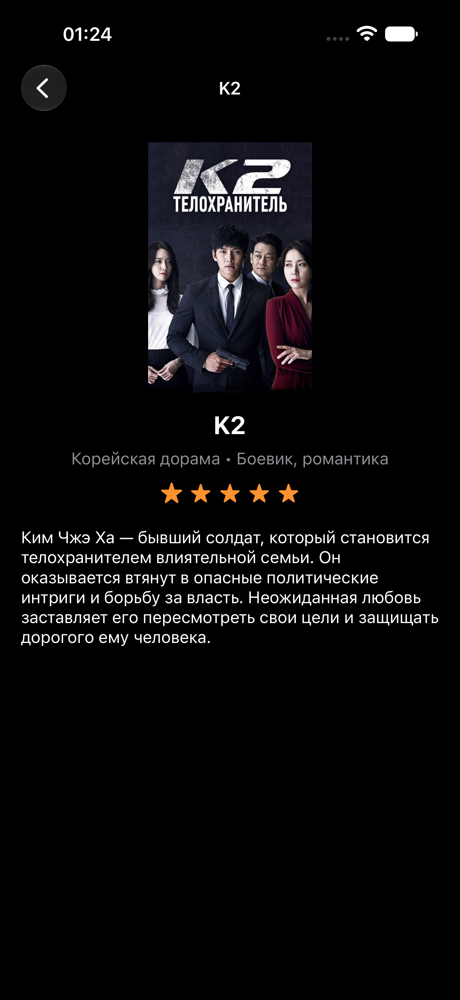
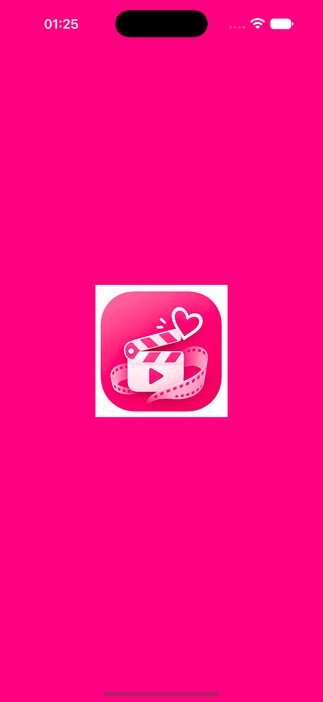
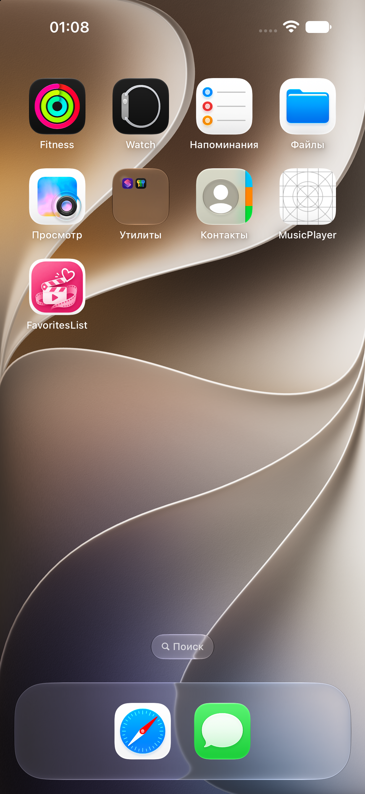

#  
# My Favorites 🎬

## Lab 10 — Favorites Navigator

**Student:** Aida Ramazanova  
**Platform:** iOS  
**Language:** Swift  
**Framework:** UIKit

## About the App

My Favorites is an iOS application that displays a collection of 20 favorite Korean dramas and Turkish TV series.

Users can browse the list of series and tap on any item to open a detailed information screen.

## Features

- 20 Korean dramas and Turkish TV series
- Custom UITableView cells
- UINavigationController
- Storyboard-based navigation
- Show Segue
- Detail screen with poster, title, subtitle, rating and description
- SF Symbols star ratings
- Auto Layout
- Custom App Icon
- Custom Launch Screen
- Light and Dark Mode support

## Screenshots

### Favorites List

### Detail Screen

### Launch Screen

### App Icon

